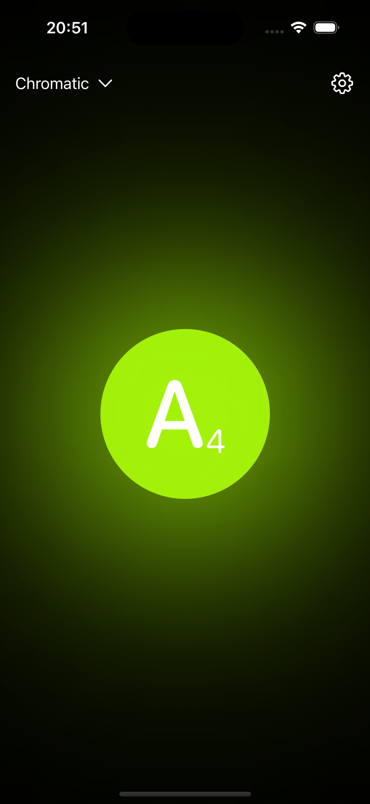
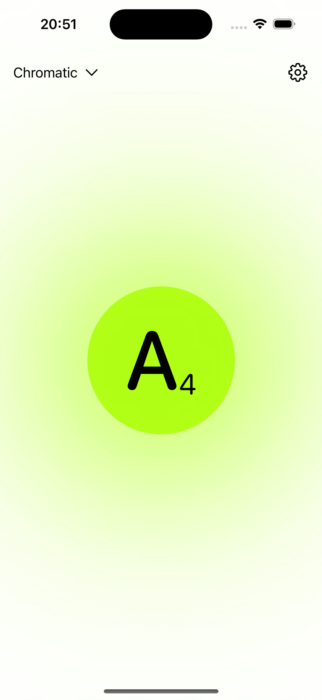

#  MyTuner

A simple chromatic tuner for iOS & macOS. Build with SwiftUI.

| Dark                                | Light                                |
| ----------------------------------- | ------------------------------------ |
|   |     |

Features:

* Beautiful, clean and simple interface

* Multiple tuning modes are available.

* Can set various data in detail

## Installation

## Bugs and feature requests

Have a bug or a feature request? Please first search for existing and closed issues. If your problem or idea is not
addressed yet, [please open a new issue](https://github.com/wxmvv/MyTuner/issues/new).

## License

[MIT License](https://github.com/wxmvv/MyTuner/blob/main/LICENSE).

## Reference tones

The reference sound bank uses short, pitch-calibrated mono recordings. The guitar comes from [FreePats Spanish Classical Guitar](https://github.com/freepats/spanish-classical-guitar/tree/6f4eb1b092acc88f5448cea1a0001bd07b971af8), the fingered flatwound bass from [Karoryfer Pastabass](https://github.com/sfzinstruments/karoryfer.pastabass/tree/90135cd026db5d4fa0fe538240b4203f085f5244), and the Kawai grand piano and marimba from [Versilian Community Sample Library](https://github.com/sgossner/VCSL/tree/c1ea7bcc3c7309650ab0da9d15c9cd1fbc4a4c7e). All four recordings are from [CC0](https://creativecommons.org/publicdomain/zero/1.0/) collections.
