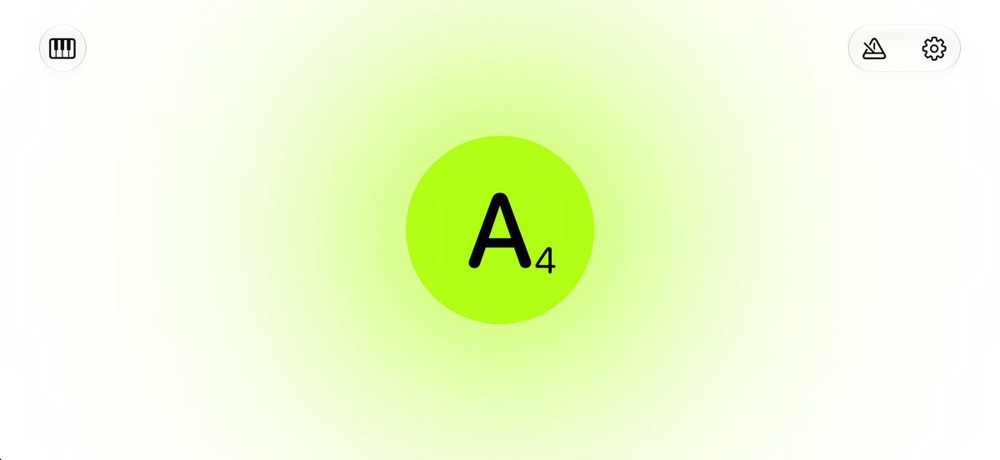
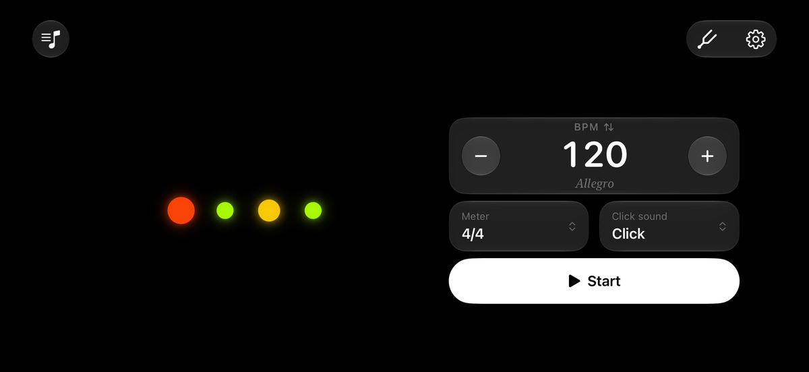
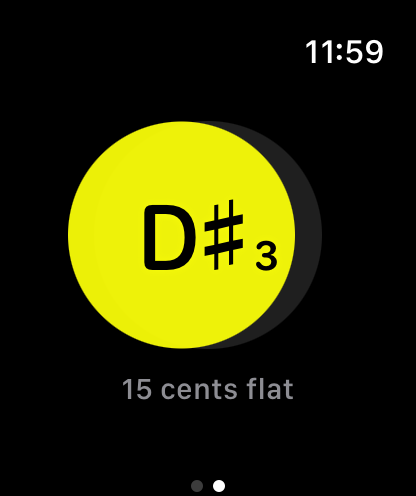
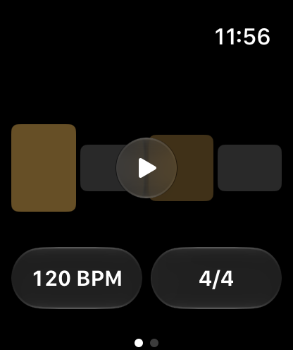

#  MyTuner

A tuner and metronome for iPhone, iPad, Mac, and Apple Watch. Built with SwiftUI.

| iPhone tuner | iPhone metronome |
| --- | --- |
|  |  |

## Features

- Chromatic and instrument tuning with adjustable pitch reference and sensitivity on iPhone, iPad, and Mac.
- Reference tones for guitar, bass, piano, and marimba.
- A metronome with custom accents, song presets, and visual beat cues.

## Apple Watch

MyTuner runs independently on watchOS 11 or later. Swipe left for the tuner and right for the metronome.

| Tuner | Metronome |
| --- | --- |
|  |  |

- **Tuner** uses the watch microphone. Once authorized, it starts listening when you open the tuner page.
- **Metronome** starts and stops when you tap the beat blocks. Tap the time signature to change meter or turn on first-beat haptics.
- **Tempo** can be adjusted with the plus and minus buttons. To use the Digital Crown, tap BPM and enable **Adjust BPM with Digital Crown**.

To run the Watch app from source, open the Xcode project and select the `MyTuner Watch` scheme.

## Installation

## Bugs and feature requests

Have a bug or a feature request? Please first search for existing and closed issues. If your problem or idea is not
addressed yet, [please open a new issue](https://github.com/wxmvv/MyTuner/issues/new).

## License

[MIT License](https://github.com/wxmvv/MyTuner/blob/main/LICENSE).

## Reference tones

The reference sound bank uses short, pitch-calibrated mono recordings. The guitar comes from [FreePats Spanish Classical Guitar](https://github.com/freepats/spanish-classical-guitar/tree/6f4eb1b092acc88f5448cea1a0001bd07b971af8), the fingered flatwound bass from [Karoryfer Pastabass](https://github.com/sfzinstruments/karoryfer.pastabass/tree/90135cd026db5d4fa0fe538240b4203f085f5244), and the Kawai grand piano and marimba from [Versilian Community Sample Library](https://github.com/sgossner/VCSL/tree/c1ea7bcc3c7309650ab0da9d15c9cd1fbc4a4c7e). All four recordings are from [CC0](https://creativecommons.org/publicdomain/zero/1.0/) collections.
